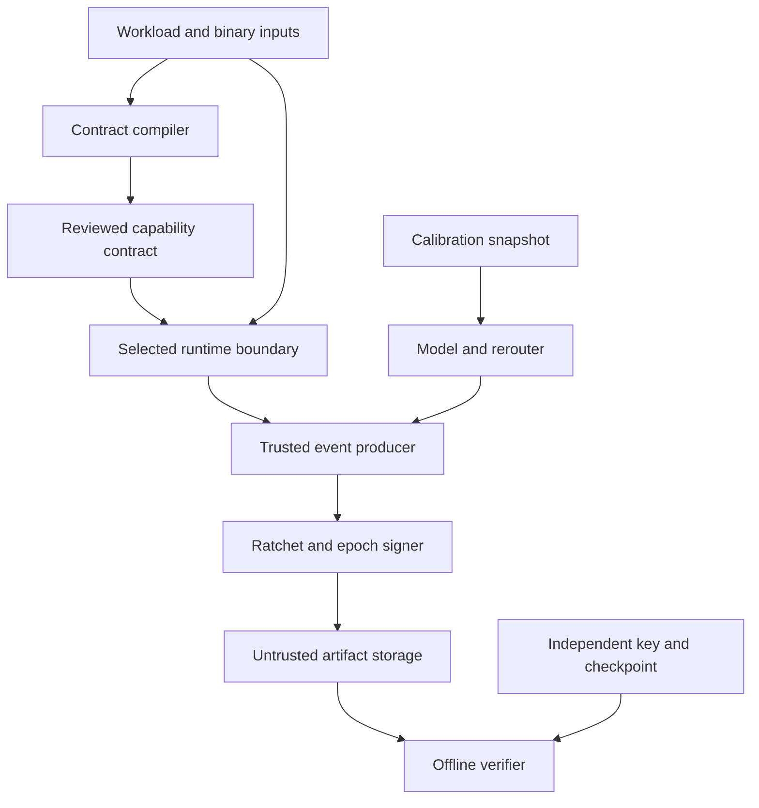

# VeriKernel threat model

I model the current implementation, with current execution evidence
recorded in [the verification report](../benchmarks/results/latest_verification_report.md).
I distinguish artifact integrity, capture completeness, identity, and confinement.
These are separate security objectives with separate trust requirements.

## Deployment and scope

I target an operator-controlled CLI, local build workloads, offline receipts,
and an optional loopback demonstration service. Contracts and fault schedules
are operator inputs; workload source, native imports, filenames, audit arguments,
receipt files, and calibration snapshots may contain adversarial values.
The browser service is local and is not an Internet identity service.
Evidence: `src/verikernel/cli/main.py:main`, `ui/server.py`, and
`type_boundaries.py:validate_bundle_dict`.

I assume the operator controls the supervisor executable, configuration, target
selection, trusted signing-key fingerprint, and any independently retained STH.
I do not assume the workload is benign in the Linux restricted profile.
I do assume the linked native adapter and interpreter remain cooperative in
their respective portable profiles. These profiles cannot confine malicious
code with the same process privileges.

## Assets and trusted computing base

| Asset | Security objective | Trusted components and evidence |
|---|---|---|
| Contract and binary identity | Bind reviewed bytes to intended capabilities | Compiler, AST/binary parsers and OmniBOR; `m1_contract/compiler.py`, `omnibor.py` |
| Captured event stream | Authenticate retained records and sequence | Producer, supported hook coverage, Rust/Python ratchet; `m2_enforcer/hal.py`, `crates/verikernel-core/src/batch.rs` |
| Native target requests | Authorize actual linked operations before execution | Native adapter and loopback supervisor; `crates/verikernel-target-bin/src/main.rs:authorize`, `m2_enforcer/native_supervisor.py` |
| Signing secret and audit seed | Prevent unauthorized resealing and historical tag computation | OS memory/file permissions, signer, caller custody; `m4_attest/pqc_signer.py`, `cli/main.py:pack_receipt` |
| Ledger checkpoint | Detect rewritten history and retained-tail rollback | ML-DSA verifier and external anchor; `m4_attest/ledger_store.py:verify_ledger_history` |
| Native memory | Preserve C-ABI memory safety | Rust compiler plus callers supplying valid, correctly sized, nonaliasing pointers; `rust_bridge.py:BatchEngine` |
| Quantum receipt | Bind model inputs, layout and calculated verdict | Snapshot source, dense simulator and scorer; `m6_quantum/subgraph_rerouter.py` |
| Distribution | Detect build drift for fixed inputs | Source tree, Python ZIP implementation, canonical builder; `scripts/build_reproducible_dist.py` |

The kernel profile additionally trusts the Linux kernel, Landlock ABI, seccomp
notification supervisor, executable loader, and installed policy.
Evidence: `crates/verikernel-core/src/sandbox.rs`, `src/verikernel/m2_enforcer/linux_hal.py`.
The disassembly check additionally trusts the decoder and exact inspected binary.
I record the library SHA-256; rebuilding invalidates the artifact-specific finding.

## Data flow and trust boundaries

| Boundary | Channel and validation | Guarantee and limit |
|---|---|---|
| Source to contract | AST, bounded binary tables, Git blob hash | Literal discoveries and inspected imports; dynamic behavior can remain undeclared |
| Runtime to producer | PEP 578 tuples, wrappers, optional kernel records | Supported operations only; hook absence is not proof of no execution |
| Native adapter to supervisor | Bounded newline JSON over loopback; random token, expected PID, real target TID | Cooperative pre-operation authorization; token possession is not OS process authentication |
| Producer to signer | Packed 128-byte records and ratchet endpoints | Retained sequence integrity conditional on trusted producer and endpoints |
| Disk to verifier | Framing checksum, validated JSON, DSSE, MTH, ratchet | Pinned key adds identity; bundled key alone establishes self-contained integrity |
| Calibration to model | Snapshot validation and explicit layout | Authenticity of hardware measurements requires an independent trusted source |
| Source to distribution | Sorted wheel members, timestamp and mode normalization, RECORD hashes | Two-build equality for fixed source/toolchain; not compiler-bootstrap trust |

## Adversary classes

### A1: Supply-chain ghost dependency injector

I allow A1 to supply Python/native dependency bytes and request undeclared
file, process, environment, library or network operations. A1 cannot change the
reviewed contract or trusted supervisor in the confined model.
The abuse path is dynamic loading or a child launch that bypasses static imports.
Supported observed targets produce typed Ghost Diff additions; strict supported
boundaries reject unauthorized requests. Transitive imports are not automatically
complete: an import table describes linker declarations, not every later load.
Evidence: `m1_contract/binary_inspector.py`, `m2_enforcer/diff_engine.py`,
`tests/test_native_binary_target.py` and `tests/test_multiprocess_ipc_supervisor.py`.

### A2: Symlink and relative-path TOCTOU attacker

I allow A2 to change writable paths or aliases between checks and uses.
Canonicalization prevents lexical alias mistakes for a stable namespace.
It does not make separate `realpath`, `stat`, and `open` operations atomic.
The portable and cooperative profiles therefore require a stable or trusted
namespace for confinement claims. Kernel object mediation and appropriately
scoped Landlock rules provide a stronger boundary, conditional on the applied
kernel policy. Readable runtime directories are explicit policy allowances.
Evidence: `m2_enforcer/hal.py:record`, `linux_hal.py:export_policy`,
`crates/verikernel-core/src/sandbox.rs`.

### A3: Mid-epoch post-compromise log attacker

I allow A3 to edit, drop, reorder, or truncate captured event bytes after a
trusted endpoint has been retained. A3 may learn the current ratchet state,
but the conditional forward-security model excludes historical seeds, old key
copies, the signing secret, and replacement of the retained endpoint.
Publishing K0 to an adversary invalidates historical tag secrecy. Offline audit
sidecars and exported ledger audit seeds must therefore remain restricted.
A3 with equal access to an unsealed spool and signer can replace an entire run;
this implementation does not supply isolated signing hardware or a protected
monotonic counter. A signed terminal state detects a shorter retained stream;
an uncommitted tail cannot establish its own prior existence.
Evidence: `m4_attest/ratchet.py`, `m4_attest/ledger_store.py`, `cli/main.py:pack_receipt`.

### A4: Quantum adversary and calibration drift

I separate cryptanalytic capability from physical drift. A quantum adversary
may apply known quantum algorithms; I assume the selected ML-DSA-65 construction
remains unforgeable under its required lattice and random-oracle assumptions.
Shor's algorithm is not a generic lattice-signature forgery method. Grover-style
search changes ideal hash work factors; it does not justify a blanket security
certification. A malicious calibration provider can report healthy values for
unhealthy hardware: a signed model receipt authenticates the supplied inputs,
not physical truth. The rerouter proves modeled unitary equivalence, not noisy
device equivalence. Evidence: `m4_attest/pqc_signer.py`,
`m6_quantum/calibration_topology.py`, `m6_quantum/subgraph_rerouter.py`.

## Conditional claims and reduction boundaries

Let H be the declared 256-bit hash, S the signed statement, and A an independently
trusted key/checkpoint anchor. Subject to correct parsing and verification:

1. A different retained leaf sequence accepted under the same anchored tree root
   requires a hash collision or a failed implementation/TCB assumption. The
   domain-separated recursive proof is given as Theorem 2 in [the paper](paper.md).
2. A modified signed statement accepted under the pinned public key requires
   signature forgery or a TCB failure. I assume ML-DSA security rather than claim
   a novel reduction from Module-LWE alone. ML-DSA analysis also involves other
   lattice assumptions and its Fiat-Shamir construction.
3. Recovering an erased past key from the present key is assumed hard under the
   deployed domain-separated hash-chain model. Collision resistance alone does
   not establish a forward-secure PRF theorem for the concatenated-hash tag.
4. Retained-tail rollback is detected only when A commits to a later checkpoint.
   A completely replaced signer, audit seed and unanchored history can form a
   different internally valid history.

## Prioritized abuse paths

| ID | Attack path | Likelihood / impact in stated deployment | Control and remaining trust |
|---|---|---|---|
| TM-01 | Workload disables startup hooks or invokes uninstrumented native code | High / high if portable mode is mistaken for confinement | Select Linux restricted profile for hostile code; cooperative coverage is explicit |
| TM-02 | Mutable symlink swaps after canonicalization | Medium / high with attacker-writable namespace | Kernel mediation or trusted namespace; `realpath` alone is insufficient |
| TM-03 | Audit sidecar disclosed, tags recomputed, new root signed with stolen key | Medium / high with shared credentials | Restrict sidecars, pin verifier key, separate producer/signer privileges operationally |
| TM-04 | Restore old ledger directory including HEAD | High / high without retained anchor | Verify a separately retained checkpoint and key |
| TM-05 | Same-user process steals native IPC token and forges requests | Medium / medium in cooperative model | Bound loopback frames and PID checks; same-user adversarial process authentication is outside this adapter |
| TM-06 | Malformed binary, JSON or C pointer crashes parser/native code | Medium / high | Checked parsers and wrappers; direct C callers remain responsible for valid allocation bounds |
| TM-07 | Calibration input lies or model omits correlated noise | Medium / high for scientific interpretation | Bind snapshot digest and model; independently authenticate calibration source |
| TM-08 | Flood causes queue pressure or prevents sealing | Medium / availability high | Backpressure, bounded queues and explicit losses; no finite-memory zero-loss theorem under unbounded load |
| TM-09 | Replace executable after hashing and before launch | Medium / high in writable deployment | Require trusted immutable executable location; current path-based launch is not atomic identity execution |

## Evidence, exclusions and operation

I test wire bijection, Merkle attacks, chained-ledger rewriting, rollback with
anchors, native denial/faults, four receipt mutations, and seeded minimization.
Finite tests support implementation confidence; they are not mechanized
unbounded proofs. The machine-code check establishes the absence of decoded
conditional branches and calls after the comparator guards. It does not prove
constant-time execution of signing, parsing, allocation, Python, or the OS.
Evidence: `tests/test_property_fuzzing.py`, `tests/test_chained_transparency_ledger.py`,
`tests/test_constant_time_machine_code.py`, `scripts/verify_constant_time_asm.py`.

I exclude compromised kernel/firmware, physical memory extraction, arbitrary
same-address-space native memory corruption, cryptanalytic breaks of the chosen
primitives, hostile source toolchains, and physical QPU validation from the
conditional guarantees. These are scope definitions rather than measured fixes.
I make no remote CI execution claim for configured jobs that have not run here.

## Compiled arithmetic and confinement boundaries

I extend the TCB with the native launcher, Job Object configuration, process-handle custody, machine decoder and fixed-size C buffer contracts. Uncooperative target modes ignore all authorization environment variables. Windows assignment occurs while the process is suspended, before its first target instruction. Its Job Object handle is not inherited. Successful controls distinguish policy denial from a broken attack workload.

For a correctly assigned Windows job without permitted breakaway, the active-process limit constrains child creation and the process-memory limit constrains committed memory. These properties rely on the NT kernel. They do not provide filesystem, network, token, desktop or cross-process memory isolation. The child-count proof is not a complete Windows security sandbox.

For a Linux process inheriting the tested filter, no-new-privileges and the architecture guard prevent privilege gain or alternate-ABI bypass of the installed socket/process-creation denial rules. Optional Landlock restrictions are installed before exec and fail closed. Existing descriptors, privileged broker capabilities, permitted syscalls and the trusted kernel define the remaining capability surface. I execute the compiled targets as UID 65534 in a real guest, without substituting a simulated filter result.

The mapped-PE IAT parser operates on owned bytes with checked bounds. Its thunk redirection test proves expected-slot replacement, not prevention of direct syscalls or malicious IAT restoration. No remote-process injection or kernel guarantee follows from this parser.

For the six inspected arithmetic exports, fixed-size expansion removes conditional transfers and calls after the public guards. Under operand-independent instruction latency and valid public addresses, their control-flow and access schedules are independent of coefficient values. This conditional statement excludes rejection sampling, SHAKE, allocators, external signature providers, speculative execution and fault attacks. The norm check scans all 256 coefficients even when the first one violates the bound. Machine evidence is tied to the inspected release-library hash.

The signed accounting record authenticates the exact observed kernel counters only when the verifier independently trusts the signer and supervisor. It is one aggregate receipt, not proof of complete per-syscall capture. Differential campaigns and measured timing complement these assumptions without replacing them with unbounded proof claims.

I use the [Windows Job Object specification](https://learn.microsoft.com/en-us/windows/win32/procthread/job-objects), [Linux seccomp filter interface](https://docs.kernel.org/userspace-api/seccomp_filter.html), and [reference Dilithium transform](https://github.com/pq-crystals/dilithium/blob/master/ref/ntt.c) to define these mechanisms.

## Primary references

I use the [ML-DSA standard](https://csrc.nist.gov/pubs/fips/204/final) as the
signature specification, not as certification of this implementation.
I use [RFC 9162 tree algorithms](https://www.rfc-editor.org/rfc/rfc9162.html#section-2.1)
with explicitly declared event/hash profiles rather than the complete certificate protocol.
The [Python audit-hook documentation](https://docs.python.org/3/library/sys.html#sys.addaudithook)
defines the portable hook interface; the [Landlock documentation](https://docs.kernel.org/userspace-api/landlock.html)
defines the separate Linux access-control boundary.
