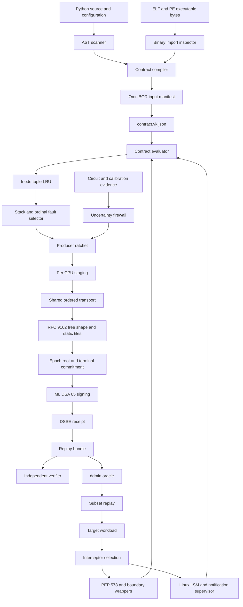
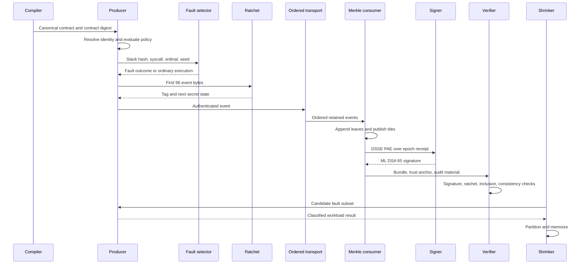
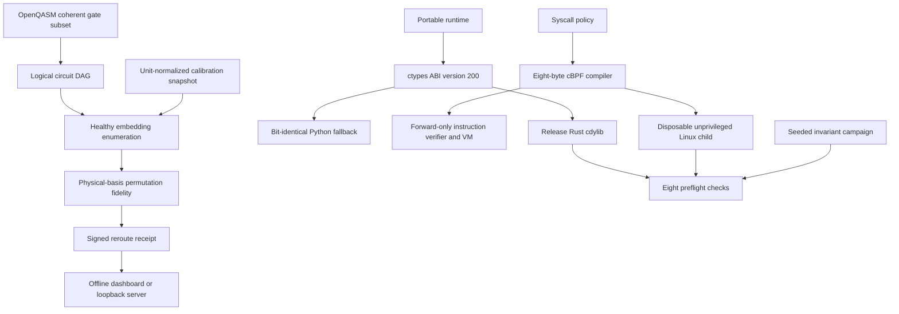
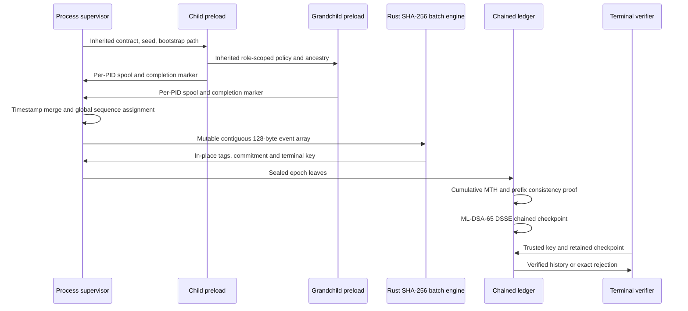
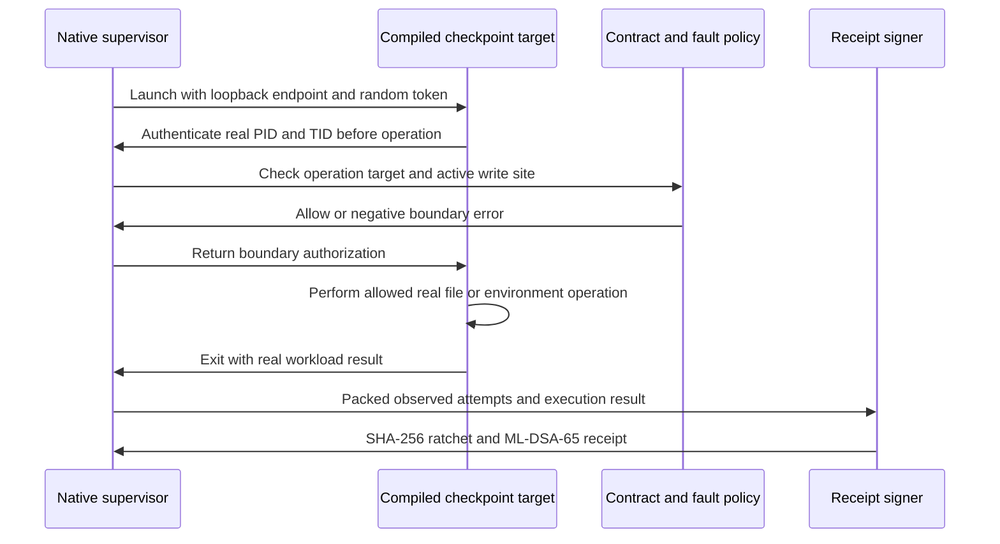

# VeriKernel execution flow

Author: Pratham Kapoor <prathamkapoor027@gmail.com>

Status: portable workflows, native Rust transport and signer, and a Linux confinement backend.
I verify Windows ARM64 and x64 builds and execute Linux ARM64 artifacts in a contained guest.
The Linux supervisor installs rust-landlock rules and a seccomp notification listener before exec.
The aya CO-RE loader seeds each per-CPU ratchet state before enabling emission.
The BPF profile uses BLAKE2b-256 per CPU; the portable default uses BLAKE3 globally.
The inode-based BPF target digest is distinct from a canonical path or network endpoint digest.
Kernel reservation failures increment loss counters and fail capture verification.
Optional bpf_override_return compilation requires kernel error-injection eligibility.
I use a native bounded shared FIFO and synchronized per-CPU staging with contiguous release.
The epoch worker seals on count or time, verifies producer tags and publishes cumulative roots.
Keys share an address space in portable execution; I do not assert protected key custody.
I distinguish intended interfaces from guarantees established by executable checks.
I use MIT licensing for this repository foundation.
I record contradictory requirements explicitly before depending on them.
I record measured fixture results in benchmarks/results/latest_benchmark_metrics.json.
Performance percentages below are experiment acceptance targets unless identified as arithmetic.

## 1. System architecture and dataflow overview

I separate contract compilation, interception, transport, fault replay, and attestation.
The compiler accepts source bytes, configuration bytes, and executable bytes.
It produces an immutable, content-addressed contract.
The runtime chooses a backend according to available platform capabilities.
The portable backend observes supported Python operations.
The Linux backend needs separately verified kernel facilities and attachment privileges.
Neither backend inherits security guarantees from the other.
The producer attaches identity, fault outcome, sequence, and authentication metadata.
The consumer builds append-only Merkle structures and signs epoch receipts.
The replay evaluator runs the workload against a fixed boundary schedule.
The shrinker reduces that schedule using an explicit failure predicate.
The quantum firewall produces a policy receipt rather than an unconditional correctness proof.

### Trust boundaries

I trust the contract author only to define permitted dependencies.
I do not treat a contract signature as proof that source behavior is benign.
I isolate signing keys from the target workload.
I keep ratchet audit seeds out of public receipts.
I authenticate the expected public key through a separately configured trust anchor.
A public key carried inside a bundle cannot authenticate its own identity.
I treat native extensions as outside the portable interception completeness boundary.
I treat child processes as outside Python audit visibility unless independently supervised.
I treat kernel support as a capability that requires an execution check.
I do not equate a successful portable test with a successful kernel attachment.
I record backend selection in every receipt.
I distinguish policy denial from workload failure.
I distinguish fault schedule reproduction from instruction replay.
I reject receipts whose algorithm identifiers are unsupported.
I fail verification closed when required evidence is missing.

### Delivery and ordering

I assign global event sequence numbers at one serialized ordering point.
Sequence order means producer admission order rather than physical clock order.
Per-CPU staging cannot independently establish a global total order.
The merger tracks outstanding reservations before releasing a contiguous prefix.
A stalled producer requires a specified cancellation or timeout mechanism.
Cancellation itself must be represented in the receipt.
An unbounded Python queue can avoid capacity drops while increasing memory usage.
A bounded transport can avoid drops only by applying backpressure or spilling durably.
A Linux ring reservation can fail when capacity is exhausted.
I expose reservation failures as counters and signed loss evidence.
I never report a universal zero-drop guarantee for a finite ring.
I never report lock freedom for a transport implemented with ordinary mutexes.
The benchmark reports observed drop rate under a declared workload.
The benchmark includes suppressed duplicates separately from discarded events.
Suppression does not prove that every underlying syscall was logged.

## 2. Byte-level wire protocol and memory layout

### Telemetry event

I use exactly 128 bytes for each serialized event.
I serialize explicitly in little-endian order.
Rust alignment is a memory placement property, not a wire encoding operation.
Rust serialization must not copy uninitialized struct padding.
The requested Python struct string is `<QQIIIIQQQQ32s32s`.
Its fourth 32-bit integer stores the fault field as an unsigned bit pattern.
Negative fault values require two's-complement conversion before packing.
Decoding subtracts 2^32 when the stored fault value is at least 2^31.
An alternative signed format is `<QQIIIiQQQQ32s32s`.
I preserve the requested wire bytes regardless of language representation.

| Offset start | Offset end | Field | Encoding |
|---|---|---|---|
| 0 | 8 | seq_no | u64 little-endian |
| 8 | 16 | timestamp_ns | u64 little-endian |
| 16 | 20 | pid | u32 little-endian |
| 20 | 24 | tid | u32 little-endian |
| 24 | 28 | syscall_nr | u32 little-endian |
| 28 | 32 | fault_injected | i32 two's-complement |
| 32 | 40 | dev_id | u64 little-endian |
| 40 | 48 | inode_nr | u64 little-endian |
| 48 | 56 | mtime_ns | u64 little-endian |
| 56 | 64 | call_stack_hash | u64 little-endian |
| 64 | 96 | target_digest | 32 raw bytes |
| 96 | 128 | ratchet_tag | 32 raw bytes |

Operation 1 represents executable dispatch.
Operation 2 represents file opening.
Operation 3 represents network connection.
Operation 4 represents executable library mapping.
Operation 5 represents environment access.
Operation 6 represents clock access.
Operation 7 represents random byte access.
Operation 8 represents quantum execution dispatch.
Operation 9 represents reading.
Operation 10 represents writing.
These are portable operation identifiers rather than Linux syscall numbers.
Fault zero records normal execution.
Fault -11 records EAGAIN.
Fault -110 records ETIMEDOUT.
Fault -28 records ENOSPC.
Fault -5 records EIO.
Fault -13 records EACCES.
Fault +1 records a short read.
Fault +2 records clock skew.
I validate integer ranges before serialization.
I require both byte-array fields to be exactly 32 bytes.
I reject trailing bytes in single-event decoding.
I record monotonic timestamp provenance in the epoch metadata.
I do not interpret monotonic timestamps as wall-clock dates.

### Hash algorithm identity

I use a named 32-byte hash profile for each complete artifact.
The BLAKE3 profile and BLAKE2b-256 profile produce different trees.
An optional import must never silently change verification semantics.
Every receipt names its hash profile explicitly.
Every reader rejects an unknown profile.
RFC 9162 supplies the tree construction and proof algorithms.
Using BLAKE3 with that construction is a custom profile, not Certificate Transparency interoperability.
GitOID SHA-256 is independent of the telemetry hash profile.
FNV-1a is suitable for deterministic stack indexing, not cryptographic authentication.
The Rust ratchet cannot substitute FNV for the cryptographic ratchet hash.

### Implemented 256-leaf static tile framing

The local tile profile defines its framing independently of the headerless Tessera profile.
I specify a local framing here and do not label it an existing Tessera wire format.
The local header is 56 bytes: struct format `<8sQII32s`.
Bytes 0 through 7 contain ASCII `VKTILE02`.
Bytes 8 through 15 contain the first global leaf index as little-endian u64.
Bytes 16 through 19 contain the valid leaf count as little-endian u32, from 1 to 256.
Bytes 20 through 23 contain the tile level as little-endian u32; this implementation writes level zero.
Bytes 24 through 55 contain H of the concatenated leaf hashes.
The signed bundle identifies the hash profile; local tile readers use that installed profile.
The body contains valid leaf hashes in index order.
Each leaf hash occupies 32 bytes.
A complete leaf-hash tile body occupies 8192 bytes.
A partial tile contains only valid hashes and has no fabricated leaves.
The header and body receive a content digest together.
Tile identity includes level, index, and valid width.
I fsync a same-directory temporary file and publish its immutable bytes with an atomic hard link.
I validate declared width, length, level, and body digest before use.
The separately exported headerless C2SP hierarchy is tested against published path examples.

### DSSE pre-authentication encoding

I sign PAE rather than raw JSON or a detached root string.
Let type_bytes be the UTF-8 payload type.
Let payload_bytes be the exact serialized statement bytes.
PAE is ASCII `DSSEv1`, one space, decimal type length, one space, type bytes.
I then append one space, decimal payload length, one space, and payload bytes.
Lengths count bytes rather than Unicode characters.
The in-toto statement payload type is `application/vnd.in-toto+json`.
The envelope carries payloadType, base64 payload, and signatures.
Each signature entry identifies a key and contains a base64 signature.
The payload statement identifies its statement version and predicate type.
The predicate binds contract identity, backend, epoch size, root, and ratchet commitments.
The predicate also binds algorithm identifiers and replay schedule identity.
I use deterministic JSON serialization when producing statement bytes.
Verification authenticates the original payload bytes before parsing their meaning.
Duplicate JSON keys are rejected by the semantic reader.

### Implemented .vkr container

I use a versioned container rather than Python object deserialization.
The format begins with bytes `56 4b 52 00 02 00 00 00`.
It follows with an eight-byte little-endian metadata length.
It follows with an eight-byte little-endian event count.
It follows with SHA-256 of metadata concatenated with event bytes.
The complete header is 56 bytes: struct format `<8sQQ32s`.
The metadata is UTF-8 JSON bounded to 16 MiB.
The event stream is a multiple of 128 bytes.
The metadata object contains manifest, public_key, and envelope fields.
The signed manifest declares expected event count and Merkle root.
The signed statement binds the manifest's semantic fields and stream root.
Verification rejects truncated sections, arithmetic overflow, and appended garbage.
Replay does not execute a script merely because it is mentioned in a bundle.
Script bytes or their digest must match the declared artifact before replay.
Bundles never contain an unencrypted production signing key.
An audit seed is confidential verifier material and is identified separately.
The CLI must explain when an exported audit seed weakens its confidentiality boundary.

## 3. Workflow 1: static contract and OmniBOR compilation

I enumerate eligible inputs under the declared repository root.
I exclude local caches, virtual environments, and version-control internals.
I read each selected input once for hashing and parsing.
I bind the exact bytes used by the compiler to the input manifest.
I decode Python source using its declared encoding.
I report syntax errors with file and line positions.
I retain import statements inside functions and conditional branches.
I record `import` and `from` statements separately from package declarations.
I resolve local module names before reporting undeclared distributions.
I exclude standard library modules using the current interpreter's module set.
I record the interpreter version used for that classification.
I normalize distribution names by case and punctuation rules.
I map scikit-learn to sklearn.
I map pyyaml to yaml.
I map pillow to PIL.
I map beautifulsoup4 to bs4.
I map opencv-python to cv2.
I map pyjwt to jwt.
An alias map is a policy input whose digest belongs in the compilation receipt.
I parse dependency requirements without treating version specifiers as module names.
I retain environment markers and optional dependency group membership.
I resolve renamed imports using an AST symbol map.
I extract literal importlib module requests.
I extract literal subprocess executable arguments from supported call forms.
I parse shell command strings cautiously and record shell semantics explicitly.
I record os.system and os.exec-family executable references.
I extract supported ctypes and cffi literal shared-library requests.
I record dynamic expressions as unresolved expressions rather than permitted wildcards.
I extract os.getenv and literal os.environ subscriptions.
I extract supported literal file-open and Path arguments.
I distinguish reads, writes, and path construction where the syntax permits.
A Path literal alone is evidence of a reference, not evidence of a file operation.
I preserve provenance positions for every extracted reference.

### ELF inspection

I validate the ELF magic, class, and byte order before reading offsets.
I support declared ELF classes explicitly rather than guessing.
The initial test fixture targets valid ELF64 little-endian images.
I validate program-header table bounds and entry sizes.
I locate PT_DYNAMIC and its bounded list of dynamic entries.
I collect DT_NEEDED offsets and identify DT_STRTAB and DT_STRSZ.
I translate virtual addresses through appropriate PT_LOAD segments.
I reject references into unbacked memory rather than slicing unrelated bytes.
I stop dynamic parsing at DT_NULL.
I bound every string lookup by the declared string table.
I reject missing NUL terminators inside that bound.
I retain dependency order while eliminating duplicate library names deterministically.
I never invoke ldd on an untrusted executable.
Synthetic images must exercise actual program-header and dynamic-table paths.

### PE inspection

I validate MZ, e_lfanew bounds, and the PE signature.
I validate the COFF and optional-header lengths.
I distinguish PE32 from PE32+ using the optional-header magic.
I read the import data directory from its format-specific position.
I translate import RVAs using validated section ranges.
I do not assume that every import table is in a section named .idata.
I bound import descriptor iteration by the file and declared directory.
I recognize the terminating zero descriptor.
I validate DLL name RVAs and NUL termination.
I reject truncated descriptors and impossible section arithmetic.
Delay-loaded imports need an explicit separate directory parser.
Synthetic fixtures must contain valid section mappings and descriptors.

### GitOID and contract emission

For bytes B, I form ASCII `blob ` followed by decimal byte length and a NUL byte.
I hash that prefix followed by B with SHA-256.
I prefix its lowercase hex digest with `gitoid:blob:sha256:`.
The manifest's first line is `gitoid:blob:sha256`.
Each remaining line is `blob ` followed by a sorted input digest in lowercase hex.
I terminate every manifest line with a newline.
I hash the manifest itself using the same Git blob rule.
The contract contains normalized permissions and input provenance.
Its identity excludes its own self-referential digest field.
I write canonical JSON to a confined temporary file before atomic replacement.
I check that the requested output stays within the operational jail.
I retain unresolved references as review evidence.
I do not silently grant them permission in strict mode.

## 4. Workflow 2: interception, identity, and ghost diffs

I choose interception mode before running the target.
Audit mode records violations without converting them to approvals.
Strict mode denies operations that the active backend can mediate.
Portable strict mode must advertise its incomplete native coverage.
PEP 578 explicitly does not establish a Python sandbox.
Python audit hooks are permanent once registered.
The context manager therefore registers a dispatcher once and changes scoped state.
The dispatcher ignores events outside the active target context.
I protect internal telemetry operations from recursive interception.
I restore every reversible wrapper when the context exits.
I track thread-local recursion state rather than one global suppression flag.
I avoid treating telemetry writes as target file accesses.
I capture file, process, socket, and DLL events where supported.
Clock and environment operations require explicit wrappers because audit coverage is incomplete.
Native calls and descendants can bypass those Python wrappers.
I record this boundary in verification output.

### File identity and race handling

I normalize display paths for readable receipts.
I use realpath to eliminate lexical relative-path differences.
Resolving a pathname and later opening it leaves a race window.
I cannot claim that realpath alone defeats symlink replacement.
On Linux, LSM file hooks can inspect the resolved kernel file object.
For userspace mediation I need handle-based checks or a secure supervisor open operation.
On Windows I need an opened handle's final path and file identity.
Checking after an ordinary open is too late for side-effecting open flags.
Create and truncate semantics require prevention before side effects.
I distinguish immutable content identity from mutable file identity.
The deduplication key is syscall, device, inode, and modification timestamp.
I retain the syscall field so read and write policies are not conflated.
I use O(1) indexed LRU lookup and update operations.
Changed modification time creates a new key and a new retained event.
An inode can be reused, and timestamp granularity is platform dependent.
I do not use deduplication as the authorization decision itself.
Every operation still receives policy evaluation when needed.
I do not suppress faults or their outcomes merely because a file key repeats.
I do not claim that metadata equality proves equal file content.

### Linux mediation

The file_open hook preserves an earlier nonzero LSM return value.
The executable hook evaluates the resolved executable identity.
The socket_connect hook evaluates address family, address, and port.
The producer reserves transport capacity and records failures explicitly.
The map configuration includes a 16 MiB shared ring.
The inode LRU capacity is 16,384 keys.
The allow map needs a canonical identity scheme shared with userspace.
A path string hash and an inode identity are not interchangeable.
Landlock setup depends on supported kernel ABI and handled rights.
Unsupported rights require an explicit weaker-mode report or refusal.
Seccomp notification requires a supervising process and carefully managed descriptors.
Continue-mode notification can introduce pointer races if used incorrectly.
bpf_override_return is restricted to eligible kprobe attachment sites.
Its availability does not imply arbitrary syscall return substitution.
Kernel configuration, privileges, BTF, loader, and verifier acceptance are separate gates.

### Ghost diff synthesis

I emit GHOST_SHARED_LIB for an undeclared native library dependency.
I emit GHOST_SUBPROCESS for an undeclared executable dispatch.
I emit GHOST_NETWORK for an undeclared endpoint or endpoint pattern.
I emit GHOST_FILESYSTEM for an undeclared file identity or access class.
I also report undeclared environment reads distinctly in evidence.
I bind every diff entry to an observation and source contract identity.
I normalize duplicate findings before emission.
I preserve operation type and canonical target in each finding.
The patch describes additions without applying them automatically.
A machine-applied patch requires the expected original contract digest.
I do not reinterpret an observed dependency as an authorized dependency.

## 5. Workflow 3: deterministic faults and delta debugging

I hash supported target stack frames using 64-bit FNV-1a.
I remove internal interception frames and normalize source locations.
I exclude interpreter bootstrap from the injection scope.
I record the filtering policy in the replay manifest.
I assign an ordinal for each stack and operation pair.
I combine stack, operation, ordinal, and master seed with fixed-width encoding.
SplitMix64 adds 0x9e3779b97f4a7c15 modulo 2^64.
It applies the xor-shift and 0xbf58476d1ce4e5b9 multiplication.
It applies the xor-shift and 0x94d049bb133111eb multiplication.
It finishes with the xor-right-shift by 31.
Probability comparisons use a defined integer threshold rather than platform float rounding.
I validate probability in the closed interval from zero to one.
I choose a fault only from kinds meaningful for the selected operation.
I raise the specified errno before side effects for pre-operation failures.
I define a short read as a shorter successful result, not an exception.
I define clock skew as a recorded offset at a wrapped clock boundary.
I log both attempted operation and injected outcome.
Replay activates exact site identities, not a newly sampled probability.
An absent scheduled site is a replay mismatch.
An unexpected site ordering is evidence of workload divergence.
Thread scheduling can still change observed boundary order.
I do not claim instruction determinism from a fixed fault schedule.

### ddmin state transitions

I require the initial candidate set to satisfy the failure predicate.
I memoize oracle results by immutable candidate-set identity.
I partition the current set into n nearly equal, stable-order chunks.
I first test chunks, then their complements, according to the selected ddmin variant.
I retain a failing reduction and reset or reduce granularity.
I increase granularity when no reduction preserves failure.
I stop when no singleton removal preserves failure.
The result is 1-minimal, not necessarily globally smallest.
General ddmin does not have an O(log N) oracle guarantee.
Oracle count depends on the predicate and partition order.
For a concrete 32-site example, I use required sites 7 and 23.
The initial set is integers 0 through 31.
At granularity 2, neither half contains both required sites.
At granularity 4, removing 0 through 7 loses site 7.
Removing 8 through 15 preserves both sites and retains 24 candidates.
Repartitioning and complement removal can discard additional unrelated chunks.
Eventually the current set contains only sites 7 and 23.
Removing site 7 makes the predicate false.
Removing site 23 makes the predicate false.
I record every actual tested subset in the shrink receipt.
I derive the transition transcript from execution rather than inventing oracle counts.
For this predicate, the reduction arithmetic is (32 - 2) / 32 = 93.75 percent.
An indeterminate oracle outcome is not equivalent to successful execution.
I distinguish timeout, infrastructure error, reproduced failure, and clean execution.
Flaky predicates require a declared statistical evaluation policy.
The new bundle binds the minimized schedule and original workload identity.

## 6. Workflow 4: ratchet, Merkle, and signature verification

I initialize the ratchet with a 32-byte secret K0.
C0 is H(`VK-RATCHET-COMMIT-V1` concatenated with K0).
For event i, Ei consists of its first 96 serialized bytes.
Ti is H(`VK-RATCHET-TAG-V1` concatenated with Ki and Ei).
Knext is H(`VK-RATCHET-STEP-V1` concatenated with Ki and Ti).
I overwrite the old mutable state before replacing it.
Python conversion to immutable bytes can leave copies beyond explicit zeroization.
I therefore make no process-memory erasure guarantee for the Python implementation.
The epoch receipt binds C0, KN, N, first sequence, and stream root.
The verifier checks the authenticated count before iterating events.
It recomputes C0 from confidential audit material.
It recomputes every tag using constant-time byte comparisons.
It evolves the same key chain and compares KN at the end.
A mismatch identifies the first affected observed sequence.
Deletion may cause a mismatch at the next surviving event.
Tail loss is established by authenticated count and terminal state.
An unsealed tail lacks an externally authenticated expected count or terminal state.
The ratchet alone cannot prove that such an unsealed tail once existed.
An independent durable checkpoint is needed for that stronger claim.
Publishing K0 permits recomputation of every event tag.
I never characterize a public audit seed as preserving ratchet secrecy.

### Merkle tree and proofs

The empty root is H of the empty byte string.
A leaf hash is H of byte zero concatenated with the leaf bytes.
A node hash is H of byte one concatenated with left and right hashes.
For n greater than one, k is the largest power of two strictly less than n.
The root splits at k without duplicating a final odd leaf.
The inclusion proof recurses into the selected subtree.
It appends the opposite subtree root after the recursive proof.
Verification consumes the last sibling at each corresponding split.
It rejects an out-of-range index and an invalid total size.
It rejects missing or excess proof nodes.
It compares the final reconstructed root in constant time.
Consistency generation uses RFC 9162 SUBPROOF with its boolean base flag.
At m equal to n, the true base flag contributes no proof node.
At m equal to n, the false base flag contributes the subtree root.
The recursion handles prefix boundaries within either side of the split.
Consistency verification reconstructs both the old and new roots.
An empty prior tree needs no proof but still requires a valid new-tree receipt.
Equal sizes require equal roots and an empty proof.
Old size greater than new size is invalid.
I test irregular sizes such as 3, 5, 6, 9, and 257.
I test all prefix sizes across bounded synthetic trees.
Proof size is logarithmic, while initial tree construction processes all leaves.

### ML-DSA-65 conformance boundary

I require 1952-byte public keys, 4032-byte secret keys, and 3309-byte signatures.
Matching lengths alone does not establish FIPS 204 conformance.
ML-DSA-65 uses a 48-byte challenge digest.
The requested 32-byte challenge is incompatible with that parameter set.
FIPS 204 public keys encode compressed t1 rather than arbitrary full t coefficients.
Secret-key encoding includes the material needed for the specified signing algorithm.
The standard includes context separation in external message processing.
Signing requires Power2Round, Decompose, MakeHint, and UseHint with exact encodings.
The t0-related rejection condition cannot be replaced by a zero residual.
With t = A*s1 + s2 and z = y + c*s1, w - A*z + c*t equals c*s2.
That algebraic residual is not itself a complete standard hint construction.
I require independent known-answer and interoperability tests before claiming conformance.
I require malformed encoding tests and message, key, and signature mutation tests.
The target below eight milliseconds is a measurement goal, not a mathematical guarantee.
Rejection sampling has input-dependent iteration count.
Pure Python does not establish constant-time secret processing.
An available provider must support the final ML-DSA-65 algorithm and message semantics.
I fail closed when no conformant provider is available.
I do not substitute a homegrown signature while keeping the FIPS label.

## 7. Workflow 5: quantum contract and uncertainty firewall

I identify the circuit, observable, transpiler version, seed, and layout in the contract.
I bind the measured calibration baseline by content digest.
I validate qubit and shot counts before allocating arrays.
I construct supported gate matrices with explicit endianness conventions.
I reject unsupported gates rather than treating them as identity operations.
I compare unitary behavior up to a declared global phase tolerance.
For observable contracts I compare the specified transformed observables.
I bind numerical tolerance and gate-set assumptions in the receipt.
Dense unitary construction grows exponentially with qubit count.
I bound supported sizes and report that limit explicitly.
I do not infer hardware equivalence from a simulator-only calculation.
I collect an ensemble of predictive probabilities when epistemic estimation is requested.
Htotal is the entropy of the ensemble mean predictive distribution.
Expected conditional entropy is the mean entropy across ensemble members.
Iepistemic is Htotal minus that expected conditional entropy.
A single model probability does not identify model ignorance.
Binomial shot variance is p*(1-p)/shots for an estimated Bernoulli probability.
I retain uncertainty about p when reporting its estimate.
Ddrift is KL divergence between declared measured and baseline distributions.
I use infinite KL divergence when calibration assigns positive mass to a reference-zero outcome.
I validate normalization and disallow negative probabilities.
I keep hardware drift and model ignorance as separate decision inputs.
ABSTAIN_HARDWARE_DRIFT takes precedence when drift exceeds policy.
ABSTAIN_OOD_IGNORANCE applies when epistemic uncertainty exceeds policy.
ADD_SHOTS applies when estimated shot variance is above its budget.
PREDICT_CERTIFIED means the configured evidence and thresholds were satisfied.
It does not certify an arbitrary quantum computer or its physical implementation.
I record policy thresholds and all uncertainty terms in the execution receipt.
I record the recommended shot count when selecting ADD_SHOTS.
I avoid claiming that additional shots remove model ignorance or calibration drift.
I serialize the receipt as a telemetry-linked leaf.
I append it to the same authenticated Merkle epoch as classical boundary evidence.
The signed receipt binds circuit identity, execution settings, and firewall verdict.
The verifier checks those bindings before accepting the action.

### Reference specifications and implementation checks

I use [FIPS 204](https://nvlpubs.nist.gov/nistpubs/fips/nist.fips.204.pdf) for ML-DSA algorithms and encodings.
I use [RFC 9162](https://www.rfc-editor.org/rfc/rfc9162.html) for tree and proof algorithms.
I use [PEP 578](https://peps.python.org/pep-0578/) for Python audit-hook semantics.
I use [kernel seccomp documentation](https://docs.kernel.org/userspace-api/seccomp_filter.html) for notification constraints.
I use [kernel BPF helper definitions](https://github.com/torvalds/linux/blob/master/include/uapi/linux/bpf.h) for helper restrictions.
Verification checks document structure, protocol arithmetic, and repository identity.
Executable checks record observed test output alongside the measured artifacts.
Linux verification needs a suitable Linux host or container with host kernel support.
Portable verification must remain honest about incomplete native interception.
Benchmark reports must distinguish measurements, simulations, estimates, and external literature.
Measured comparisons and the runtime configuration are recorded in benchmarks/results/latest_benchmark_metrics.json.

### Executable native transport and epoch protocol

NativeEventQueue binds a Rust crossbeam ArrayQueue through fixed-width C functions.
I copy exactly 128 bytes at enqueue and decode exactly 128 bytes at dequeue.
The queue returns a full condition rather than overwriting unread events.
Each Python L1 cache has its own synchronization and flushes into the shared queue.
Ordered release tracks both buffered sequence numbers and explicit suppressed indices.
I hold later records until the next sequence is present or deliberately suppressed.
Epoch admission serializes the global ratchet before publishing bytes.
The signing thread independently verifies tags with its evolving audit state.
It never trusts a mutable caller record retained after submission.
An epoch checkpoint binds count, cumulative root, commitment, terminal key and hash profile.
Each checkpoint also binds its predecessor envelope digest and RFC consistency proof.
The final bundle signs all epoch envelopes and the original workload manifest.
A stopped or overloaded signer cannot establish an unconditional wall-clock seal bound.

### Published tile hierarchy

I publish headerless hashes under tile/L/N and tile/L/N.p/W paths.
Each full tile contains 256 ordered 32-byte hashes, totalling 8192 bytes.
Higher levels contain roots of completed groups of 256 hashes from the level below.
I encode large indices in three-digit groups prefixed by x for intermediate groups.
I publish immutable bytes using a same-directory fsynced temporary file and atomic hard link.
An existing path must contain exactly the same bytes or publication fails.
The local VKTILE02 framed format remains available for explicit integrity checks.
The local framing is separate from the headerless C2SP layout.
I use a custom BLAKE3 hash profile and do not advertise default Tessera checkpoint compatibility.

### Kernel execution evidence

I execute the capture smoke test with all four hooks attached through aya.
The target opens and reads a file, attempts a socket connection, and execs a new binary at the same PID.
The measured stream contains 45 events and operations 1, 2, 3 and 9.
Every per-CPU key evolves from a distinct random seed and matches the recorded terminal state.
I reject a stream with nonzero reservation losses or an invalid ratchet.
The supervisor's notification loop checks POLLIN rather than treating POLLHUP as an available message.
I verify the shutdown correction on both declared-file success and denial.
I also verify copied-address connection mediation with exact allowed and denied numeric endpoints.
I execute those confinement checks as root and UID 65534.
The current probe filter targets one PID; the seccomp supervisor observes inherited notifications.
Portable fault replay remains the default across operating systems, including Linux.

### Native supervisor streaming bridge

I stream native notifications as newline-delimited JSON through a private parent pipe.
The header identifies the BLAKE3 profile, audit seed and initial commitment.
Each event record carries exactly 128 binary bytes encoded as hexadecimal and its observed target.
The footer commits to the final key, event count and child wait status.
I verify every native tag before submitting the record to the asynchronous epoch service.
The bridge rejects missing headers, unknown profiles, sequence gaps, altered tags and missing footers.
It rejects any data following the terminal record.
The epoch service signs checkpoints while the native child is still executing.
Native trace receipts include those checkpoints and the machine-applicable observed contract additions.
I grant the interpreter executable, virtual-environment configuration and runtime libraries explicitly.
I preserve strict Landlock policy rather than implicitly granting a declared file's parent directory.
The supervisor handles termination requests and cleans up its workload process group on exit.
I do not extend the receipt lifetime to deliberately detached tasks after the main workload exits.
# Native integration and verification flows

I retain the original protocol and execution specifications below and extend them with the following integration boundaries.

I locate the native library under package paths, ignored `dist/native/<triple>/` or release build paths.
I validate ABI version 200 and telemetry size 128 before calling arithmetic exports.
I retain ctypes-owned buffers throughout each synchronous call.
The pointer ABI requires valid readable input and writable output ranges from every foreign caller.
The fixed-leaf Merkle export accepts 256 bytes per leaf; arbitrary event payloads use the normal Merkle API.
I compare FNV-1a on identical 1,024-byte buffers, including ctypes overhead in the native timing.

I encode each classic BPF instruction as `<HBBI`: code at bytes 0–1, true jump at 2, false jump at 3 and immediate at 4–7.
The filter loads audit architecture at offset 4 before the syscall number at offset 0.
Architecture mismatch terminates the child; x86_64 additionally rejects x32 syscall-number confusion.
I emit equality checks with forward branches to notification, errno or allow returns.
The VM rejects unsupported opcodes, invalid offsets, incomplete instructions and any branch beyond the program.
It validates all instructions, including unreachable instructions, before execution.
I run the real filter only in a disposable Linux process and record kernel and effective uid.
I authenticate its two telemetry records before recording success.

I parse only supported unitary gates and terminal measurements from OpenQASM 2/3.
I preserve logical dependency edges, safe arithmetic rotation parameters and injective physical labels.
I normalize supplied calibration time units and retain the directed coupler map.
Synthetic default snapshots are marked synthetic throughout the receipts and dashboard.
The layout search rejects unhealthy qubits and absent gate couplers, then maximizes the survival-product score.
I compute the matrix in sorted active-physical order and compare it through the logical-to-physical permutation.
I seal calibration identity, original and replacement layout, expected scores and measured unitary fidelity together.

I run finite seeded invariants before interpreting the dashboard evidence.
The ratchet diagnostic records a verification index independently of the untrusted event sequence field.
I check all tree prefix pairs through 130 leaves, changed proof nodes and altered leaf bytes.
I test removal of every retained fault from each minimized schedule.
These checks improve finite coverage without constituting an unbounded proof.

I publish receipt files without overwriting existing evidence and publish the bundle after its supporting artifacts.
The standalone dashboard embeds recorded measurements and requires no external resources.
The loopback server reruns each attack against the signed demonstration bundle.
I enforce Host and Origin checks, fixed routes and bounded request bodies before accepting an attack request.
I expose four concrete attacks: payload mutation, checkpointed tail deletion, event swapping and out-of-bound signature response encoding.
The Merkle inspector displays original and altered branch hashes computed from the actual payloads.
I do not infer the existence of an entirely uncheckpointed suffix from a retained prefix.

I run nine preflight checks in dependency order: workspace, identity, source, Rust, Python, CLI, Linux, evidence and quality.
Each gate records its actual duration and result, retaining command logs under ignored `dist/preflight/`.
The CI matrix configures Windows, Linux and macOS jobs; only completed runs count as execution evidence.
Pre-existing sibling projects remain untouched and are reported separately from containment of new outputs.

## Continuous verification workflows

I keep existing BLAKE3/BLAKE2b receipts separate from the explicit SHA-256 batch profile.
Each input event still occupies exactly 128 bytes, with the tag at offsets 96–127.
The ctypes event view borrows the bytearray without copying it.
The caller must retain exclusive ownership while the native function runs.
Key and output buffers must be valid, adequately sized and nonoverlapping.
The SHA-256 compression code uses only standard Rust arithmetic and storage.
The surrounding workspace still requires its existing dependency cache for offline compilation.
I measure build duration rather than infer a hardware-independent two-second limit.
Batch sealing writes C0 and KN, and volatile-clears previous native mutable key states.
Batch verification scans every event, retaining the first failed index.
Status zero means valid, minus one means authentication/sequence failure, minus two means terminal failure, and minus three means invalid pointer/size parameters.
A commitment failure reports index minus one; a terminal mismatch reports the retained event count.
The Merkle export hashes empty input, prefixed 128-byte leaves and prefixed pairs of child roots.
The deduplicator emits a byte mask and returns the sum of its retained entries.
Its capacity bounds batch-local LRU state; capacity zero disables suppression.
All raw events remain policy inputs before any telemetry summarization.

I create each process bootstrap under `.tmp/ipc_<run_id>/`.
The config points to the copied contract and contains enforcement and fault settings.
Python startup installs the typed child interceptor before workload execution.
Each interpreter opens its own append-only spool and emits a startup event.
I record actual interpreter PID/TID plus both OS and supervised parent relationships.
This preserves Windows launcher ancestry without substituting launcher PIDs into events.
Fault schedules are scoped by stable script role, not unstable numeric PID.
Every emitted record is flushed through an unbuffered process-owned file.
Completion metadata is published after hooks are removed and the spool is closed.
I reject missing completion markers and nonmultiples of 128 bytes.
I sort completed records by monotonic timestamp, PID and original local sequence.
I assign contiguous global sequence numbers and drain the ordered parent transport.
I batch-seal the merged payload and bind the process tree and Ghost Diff into the signed manifest.
Cooperative preload cannot establish coverage of deliberately escaped or native processes.
The CLI selects this mode through `--backend multiprocess` for trace, enforce or fault.

I retain one immutable binary leaf file, private audit seed and public signed record per ledger epoch.
An exclusive lock pathname serializes append operations.
I verify committed history before extending it.
I assign epoch-local wire sequence numbers and keep cumulative Merkle indices separately.
Each checkpoint binds the preceding checkpoint identity, local root and terminal key.
I compute the current cumulative root and RFC 9162 prefix consistency proof.
I sign the checkpoint with ML-DSA-65 under DSSE encoding.
I publish supporting files before atomically replacing HEAD.
I refuse conflicting immutable records and require the original signer to append after reopening.
Verification authenticates every signature and ratchet, recomputes cumulative roots and checks all links and proofs.
A retained external checkpoint detects whole-tail rollback; an old self-consistent directory alone cannot.
An independently pinned public key establishes identity beyond bundled integrity.
Exported offline audit history contains sensitive seeds and must remain private.

I compare cryptographic bytes with constant-time primitives and scan whole ratchet streams.
The signature guard validates response bounds and canonical hint encoding before selecting backend work bytes.
I preserve original-encoding validity independently, so normalization cannot authorize a forged signature.
I interleave first/last corruption classes and retain all 2,000 observations per class.
I compute sample means, unequal sample variances and the Welch statistic directly.
I retain the initial observed timing failure and report subsequent code changes and measurements.
I do not discard outliers, add sleep padding or resample unchanged code to obtain acceptance.
Five frozen KATs cover Git blob identity, event bytes, SHA-256 ratchets, uneven trees and deterministic FIPS 204 signatures.

The inspector verifies signatures, roots and ratchets before presenting decoded records.
It displays all wire offsets, computed Merkle branch nodes, process counts, diffs and fault schedules.
Its JSON form retains the same verified data for downstream tools.
The quality gate parses Python ASTs and Rust syn ASTs independently.
It checks annotation and documentation coverage, prohibited statements, repository text and private-directory custody.
Explicit dynamic annotations remain counted boundaries; coverage is not a sound typing or dead-code theorem.
I archive completed transient artifacts under ignored `dist/` before the strict empty-temp gate.
Benchmark 5 retains all three throughput trials, their median and anchored four-epoch verification latency.
# Distribution and native boundary verification

I extend the existing flow with artifact-specific machine-code inspection,
validated serialization boundaries, a compiled checkpoint workload and normalized
distribution builds. I retain the earlier profile distinctions.

## Comparator inspection

1. I build the release cdylib for the interpreter architecture.
2. I resolve `vk_constant_time_compare_32` from its exported symbol.
3. I independently map PE export RVA to on-disk section bytes.
4. I decode instructions with LLVM objdump or a compatible objdump.
5. I identify the public pointer guards before the first comparison load.
6. I inspect the comparison body through its return instruction.
7. I reject conditional branches, indirect control transfers and calls in that body.
8. I bind the instruction count and hex bytes to the inspected library SHA-256.
9. I separately test null pointers, equal data and a change at every byte position.
10. I use the exported primitive for native batch ratchet comparisons.

This establishes a property of the decoded artifact; timing observations retain
their separate statistical interpretation. Rebuilding requires fresh inspection.

## Serialization boundary checks

I represent JSON scalars, arrays and string-keyed objects explicitly.
I reject non-finite floats, non-string object keys, opaque objects and nesting
deeper than 64 levels. The contract validator checks capability lists and input
identity maps. The receipt validator checks manifest shape, event count,
32-byte roots/endpoints and the 1,952-byte public key before verification.
The DSSE validator checks the single-signature profile before base64 decoding.
The audit tuple validator checks the handled runtime event shapes.
The ctypes layout descriptor fixes tag offset 96 and total length 128.
The source audit rejects catch-all dynamic annotations, including imported aliases.
Opaque values remain `object` until narrowed; this annotation audit is not sound
whole-program type inference.

## Compiled native checkpoint flow

I inspect the executable's real PE/ELF imports and bind its GitOID.
The target performs durable checkpoint writes, read-back and checksum work.
Its linked adapter requests authorization for process start, file open, read,
write and environment access. The supervisor records operation attempts with
actual process/thread identifiers; an authorization record is not a successful
kernel-completion record. Strict undeclared access returns an error before I/O.
An active checkpoint write site returns injected ENOSPC and causes a nonzero
exit. Repeated real target runs serve as the reduction oracle.
The target adapter and executable location are trusted. Arbitrary uninstrumented
native programs require a kernel backend for confinement and complete supported
syscall capture; this cooperative channel does not establish either by itself.

## Canonical distribution flow

I independently reread source for build runs 1 and 2 under a contained temporary
directory. I normalize text line endings, sort POSIX archive names, fix permissions
to 0644, pin `SOURCE_DATE_EPOCH=1760486400`, and emit valid wheel metadata and
RECORD hashes. I include Python packages, Rust sources/schemas and project metadata.
I compare whole-artifact SHA-256 and OmniBOR GitOID. I then install the wheel
offline with dependencies and bytecode disabled, import its schema from the fresh
installation, and verify the 128-byte descriptor. I copy the verified wheel to
ignored `dist/` and remove the temporary build/install directories.
The comparison fixes the source and ZIP toolchain; native shared libraries are
separate platform artifacts and are not claimed reproducible by this experiment.

## Security interpretation

I define the TCB, four adversary classes, trust boundaries, conditional reductions
and prioritized abuse paths in [threat-model.md](docs/threat-model.md).
I prove the wire, minimality, Merkle, retained-endpoint and unitary relations under
explicit premises in [paper.md](docs/paper.md). The final tenth preflight gate
combines instruction inspection, source annotation rejection, reproducible package
comparison and real compiled-target tests. It does not turn those finite checks
into a proof of arbitrary runtime behavior.
# Compiled arithmetic and native confinement

I preserve the existing capture and bundle flows and add the following explicit paths.

1. The release library exports Montgomery reduction and conditional addition modulo 8,380,417.
2. Forward transforms consume 256 signed 32-bit coefficients and use fixed bit-reversed roots.
3. Inverse transforms follow invntt_tomont scaling; the bridge documents the Montgomery radix.
4. Pointwise Montgomery multiplication and inverse scaling cancel for ordinary ring products.
5. The norm check reads every coefficient with volatile loads and combines rejection bits.
6. Native-ring key generation and signing use cloned standard protocol/ring objects, preserving provider isolation.
7. The default maintained native signer remains selectable independently of this provider.
8. The disassembler resolves six exact exports, maps decoded instructions to actual file bytes and records the release hash.
9. Public pointer/bound guards precede the data body. Conditional branches and calls in the inspected data body reject the audit.
10. Independent integer convolution, exhaustive fault truth tables, hashlib and recursive reference trees supply separate oracles.
11. Windows confinement creates a Job Object before a suspended native process executes.
12. ActiveProcessLimit is one; ProcessMemoryLimit is 16 MiB; kill-on-close prevents an abandoned job surviving its supervisor.
13. An explicit handle list admits only the target's required standard handles.
14. Assignment failure terminates the still-suspended process. Successful assignment precedes thread resume.
15. Unrestricted child creation and touched-memory controls establish that attack operations work without limits.
16. Restricted operations expose actual OS denial results and kernel accounting counters.
17. Canonical accounting JSON is hashed into one aggregate event and sealed through the chained ledger.
18. Accounting verification checks both ledger integrity and the exact payload digest; it is distinct from syscall capture.
19. Linux confinement executes a compiled launcher which applies no-new-privileges and an architecture-checked seccomp filter before exec.
20. Socket and process-creation calls receive EACCES. Optional Landlock read roots additionally restrict filesystem access.
21. The contained Linux guest runs the compiled targets as UID 65534, comparing restricted and unrestricted operations.
22. Windows resource limits and Linux access-control policies have different coverage; neither implies universal native syscall logging.
23. PE IAT enumeration operates on a bounded owned mapped image and verifies the old slot value before redirection.
24. The arithmetic verification check checks the six machine-code bodies and differential campaigns; the confinement check repeats actual kernel denial experiments.
25. Reports retain finite timing observations, artifact hashes, independent seeds and current kernel/backend identities.

The expanded arithmetic has fixed instruction/data-access schedules for valid fixed-size buffers under the stated compiler and machine model. This finding does not certify complete ML-DSA signing, its rejection sampler, Python execution or hardware latency. Kernel confinement trusts the enforcing kernel, configured limits, executable identity and supervisor custody.
